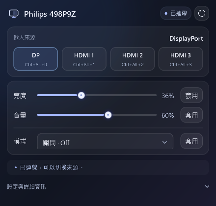

# Display Studio

A minimal Windows panel for Philips monitor input switching, brightness, volume, and LowBlue mode control.



適用於這台 Philips 498P9Z，Windows 11／Windows PowerShell 5.1。免安裝、無網路服務、無需系統管理員權限。

## 簡潔介面（1.4）

1.5 改為預設 440 × 460 的小型面板，縮減標頭、卡片留白與來源按鈕；常用控制集中在一個小視窗。最小可縮至 400 × 340，內容超出時可捲動；設定區仍可展開使用。

1.6 加入專屬的極簡螢幕標誌，開啟後顯示在面板左上角，並作為標題列、工作列與 EXE 的圖示。標誌使用向量繪製；`assets/logo.svg` 為透明底向量檔，`assets/logo.png` 為預覽，`assets/app.ico` 包含 16–256 像素的九種尺寸。重新執行 BuildLauncher.ps1 會先由面板內的向量資源產生圖示，再編譯啟動檔。

主畫面保留來源切換、亮度、螢幕音量和 SmartImage；以半透明卡片、細邊框及柔和光暈呈現玻璃質感。這是視窗內的視覺效果，不會模糊後方桌面。正常讀回值與重複說明預設收起，只有尚未套用、不可用或操作結果需要注意時才顯示提示。

右上角圓形箭頭可重新偵測；「設定與詳細資訊」內有目標螢幕、連線摘要、來源代碼、快捷鍵和操作紀錄。快捷鍵衝突與未確認的切換結果仍顯示在主畫面。更新後請關閉舊視窗，再重新開啟 MonitorInput.exe。

## 從 GitHub 原始碼建立

下載或 clone 此專案後，使用 **Windows PowerShell 5.1** 執行：

```powershell
powershell.exe -NoProfile -STA -ExecutionPolicy Bypass -File .\BuildLauncher.ps1
.\MonitorInput.exe
```

建置使用 Windows 內建的 .NET Framework 編譯器，不需安裝額外套件。`MonitorInput.exe` 為產生檔，不納入 Git；請保留 `.ps1`、`.cs` 和 `assets` 資料夾，執行時仍會使用它們。

## 開始使用

1. 保留整個資料夾，雙擊 **MonitorInput.exe**。若下載的是 ZIP，先全部解壓縮。
2. 工具會尋找 Philips 498P9Z，並讀取螢幕目前回報的輸入來源。
3. 按 DisplayPort、HDMI 1、HDMI 2、HDMI 3，或使用對應快捷鍵。
4. 最小化後快捷鍵繼續有效；關閉視窗便結束程式並解除快捷鍵。

| 來源 | 預設快捷鍵 | VCP 0x60 的預設數值 |
|---|---|---|
| DisplayPort | Ctrl＋Alt＋0 | 0x0F |
| HDMI 1 | Ctrl＋Alt＋1 | 0x11 |
| HDMI 2 | Ctrl＋Alt＋2 | 0x12 |
| HDMI 3 | Ctrl＋Alt＋3 | 0x13 |

這些數值由目前螢幕能力清單與飛利浦控制實作推得，接孔與畫面的對應仍應逐一確認。可以在「設定與詳細資訊 → 快捷鍵與進階設定」修改代碼，代碼使用十六進位，例如 `11` 或 `0x11`。

## 接孔連線狀態（1.1 新增）

「設定與詳細資訊」內會列出 Windows 偵測到的 DisplayPort 與 HDMI 連線，包含已偵測但未啟用的輸出。按右上角的重新偵測圖示更新，摘要會顯示偵測時間。

- **本機已偵測**：Windows 回報這台電腦與目標螢幕的 DP 連線可用。
- **接線狀態未知**：無法判定該實體接孔是否有線材／其他設備，並非未接線。
- Windows 即使偵測到 HDMI，也無法直接得知螢幕端是 HDMI 1、2 或 3，因此不會把任一編號擅自標成已接線。
- 另一台電腦或遊戲機的線材與訊號不能從本機的 Windows 連線資訊判定；目前選取的輸入來源也不代表該來源有訊號。

若同時有多台相同型號，摘要會列出本機偵測到的所有 498P9Z 連線。主畫面的來源按鈕只標示目前讀回的來源，不把它當成接線或訊號狀態。

## 快捷鍵設定

展開「設定與詳細資訊 → 快捷鍵與進階設定」，輸入組合後按「儲存設定」。支援 Ctrl、Alt、Shift 搭配 A–Z、0–9、F1–F24，至少包含 Ctrl 或 Alt。留白可以停用單一快捷鍵。數字是鍵盤上排數字鍵。

若組合已被其他程式占用，會顯示錯誤；儲存失敗時會嘗試恢復原組合。啟動時個別快捷鍵註冊失敗不影響來源按鈕。在設定區編輯時，來源快捷鍵暫停切換。

## 螢幕亮度與音量（1.2 新增）

兩個滑桿分別控制螢幕亮度與螢幕喇叭音量，範圍為 0–100%。移動滑桿後按該列右側「套用」才會送出設定；開啟工具與重新偵測只讀取，不會套用以前的亮度或音量。

實際控制的是 DDC/CI 亮度 `0x10` 與螢幕音量 `0x62`，不是 Windows 總音量、耳機或其他藍牙喇叭的音量。百分比依螢幕回報的最大值換算。每次套用後會讀回確認；讀不到時不會假裝設定成功。

若某項控制讀取失敗或回報無效範圍，該列會停用並顯示原因。HDR、特殊影像模式或螢幕韌體可能限制亮度控制；音量設定後是否出聲，還取決於電腦的音訊輸出、螢幕音源及靜音設定。程式不會自動解除靜音或更改電腦音訊輸出。

## SmartImage Off／LowBlue（1.3 新增）

在「影像模式」選擇 `Off` 或 `LowBlue`，再按該列「套用」。切換後會讀回模式，並重新讀取亮度與音量。選擇下拉項目、開啟工具、重新偵測，都不會自動改變模式。此版只提供這兩個已確認代碼，不調整 LowBlue 強度。

此台 498P9Z 曾在 LowBlue 下接受亮度數值，畫面背光卻不變；使用者切回 Off 後確認可以調整亮度。因此本工具在讀到 LowBlue 時，會暫停亮度滑桿與亮度寫入，避免數值成功卻讓使用者誤以為背光已改變。切回 Off、讀取成功後恢復亮度控制；音量仍可獨立操作。

模式使用 VCP `0xDC`，Off 為 `0x00`、LowBlue 為 `0x0B`。模式是非連續列舉值，不能用它回報的 maximum 當作數值上限；工具只接受上述兩個代碼。讀到其他模式時會明確顯示代碼，不假設是 Off。

## 切換後返回本機

切到其他電腦或遊戲機後，會維持在該來源，**不會自動切回**。本機程式仍開啟時，可用 Ctrl＋Alt＋0 嘗試返回 DP；鍵盤必須仍控制本機。

有些螢幕不接受來自非目前輸入的 DDC/CI 指令，或切換後不再提供該連線的監視器控制介面。這時快捷鍵無法保證返回，請使用螢幕實體按鈕選 DisplayPort。請以 TEST-RESULTS.md 記載的本機測試結果為準；讀回數值不代表已人工確認外部設備的實際畫面。

## 狀態如何解讀

- 「螢幕已回報 HDMI …」：寫入後讀到相同來源數值；實際畫面仍需觀察。
- 「指令已送出，尚未確認」：Windows 接受寫入，但螢幕讀回失敗或數值不符，不能當成切換成功。
- 「切換未完成」：未取得成功送出的確認。可重新偵測，或用螢幕實體按鈕返回 DP。
- 沒有訊號的來源可能會被螢幕拒絕或自動跳回，依螢幕選單設定與韌體而定。
- 若 DDC 沒回應，確認螢幕的 DDC/CI 已啟用、連線正常；經過擴充座或 KVM 也可能影響控制。

顯示驅動操作在背景執行，介面不會等待硬體而凍結。操作未結束時不排隊或重複寫入；若驅動一直不返回，工具會顯示等待訊息，可關閉再開啟。程式只修改選定的輸入來源、SmartImage 模式、亮度或螢幕音量，不修改 PBP、電源或 Windows 顯示拓樸。

## 設定與紀錄

儲存在 `%LOCALAPPDATA%\MonitorInputPrototype\`：`settings.json`、`activity.log`。紀錄保留近期操作與錯誤，無網路傳送。設定檔損壞時會提示並使用預設值；下次儲存前保留原檔備份。程式只自動選擇唯一的 498P9Z，不會把指令送到其他品牌或虛擬螢幕。

## 原始碼與指令模式

`MonitorInput.exe` 是 .NET Framework 圖形啟動器，載入 Windows 內建 PowerShell 引擎執行 WPF 介面。`MonitorInput.ps1` 管理 UI、設定及指令模式；`MonitorNative.cs` 實作背景 DDC/CI 與快捷鍵。只對 VCP `0x60`、`0x10`、`0x62`、`0xDC` 寫入。

開發者可在 Windows PowerShell 使用以下指令；`Switch` 會實際改變螢幕輸入：

```powershell
powershell.exe -NoProfile -STA -ExecutionPolicy Bypass -File .\MonitorInput.ps1 -Action Probe
powershell.exe -NoProfile -STA -ExecutionPolicy Bypass -File .\MonitorInput.ps1 -Action Read
powershell.exe -NoProfile -STA -ExecutionPolicy Bypass -File .\MonitorInput.ps1 -Action Switch -Source DP
powershell.exe -NoProfile -STA -ExecutionPolicy Bypass -File .\MonitorInput.ps1 -Action SetBrightness -Value 70
powershell.exe -NoProfile -STA -ExecutionPolicy Bypass -File .\MonitorInput.ps1 -Action SetVolume -Value 30
powershell.exe -NoProfile -STA -ExecutionPolicy Bypass -File .\MonitorInput.ps1 -Action SetSmartImage -SmartImageMode LowBlue
powershell.exe -NoProfile -STA -ExecutionPolicy Bypass -File .\MonitorInput.ps1 -Action SelfTest
```

`-MonitorId` 可明確指定 Probe 回傳的 Id。CLI 無法唯一判定螢幕時會拒絕切換。`SetBrightness`／`SetVolume` 必須明確提供 `-Value`，以免漏填時意外設為零。`SetSmartImage` 必須明確提供 `-SmartImageMode`。`Probe`／`Read` 回傳目前亮度、音量與 SmartImage 模式。`-StateDirectory` 可替測試指定獨立設定目錄。

參考：[Windows SetVCPFeature](https://learn.microsoft.com/en-us/windows/win32/api/lowlevelmonitorconfigurationapi/nf-lowlevelmonitorconfigurationapi-setvcpfeature)、[Windows 螢幕連線資訊](https://learn.microsoft.com/en-us/windows/win32/api/wingdi/ns-wingdi-displayconfig_path_target_info)、[飛利浦 MultiView 控制實作](https://github.com/n14395/philips-monitor-control)。此工具並非飛利浦官方軟體。
